# Nuvora CRM

**CRM operacional full-stack para portfólio.** Uma API REST multi-tenant em NestJS e uma SPA em React/TypeScript com uma interface Precision UI compacta, keyboard-first e orientada a dados.

<p>
  
  
  
  
  
  
</p>

<p align="center">
  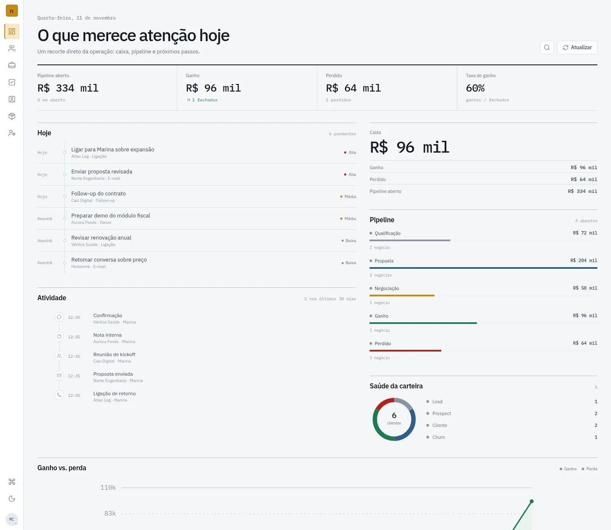
</p>

## Sobre o projeto

O Nuvora CRM é um projeto de portfólio que cobre o ciclo comercial de uma pequena ou média empresa: cadastro de organização e usuários, clientes, contatos, interações, tarefas, negociações com itens, catálogo de produtos e um dashboard operacional.

O frontend **não usa mocks**: todas as telas consomem a API real, com autenticação JWT, isolamento por organização e regras de acesso por papel. O banco pode ser populado com uma organização de demonstração reproduzível pelo seed.

> Não é apresentado como um SaaS comercial completo. Cobrança, anexos, notificações em tempo real e integrações externas estão fora do escopo atual.

## Screenshots

<table>
  <tr>
    <td width="50%">
      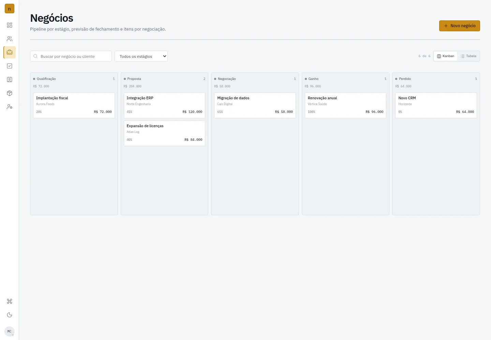
      <br><sub><b>Pipeline</b> — kanban por estágio, com valor, probabilidade e troca de etapa.</sub>
    </td>
    <td width="50%">
      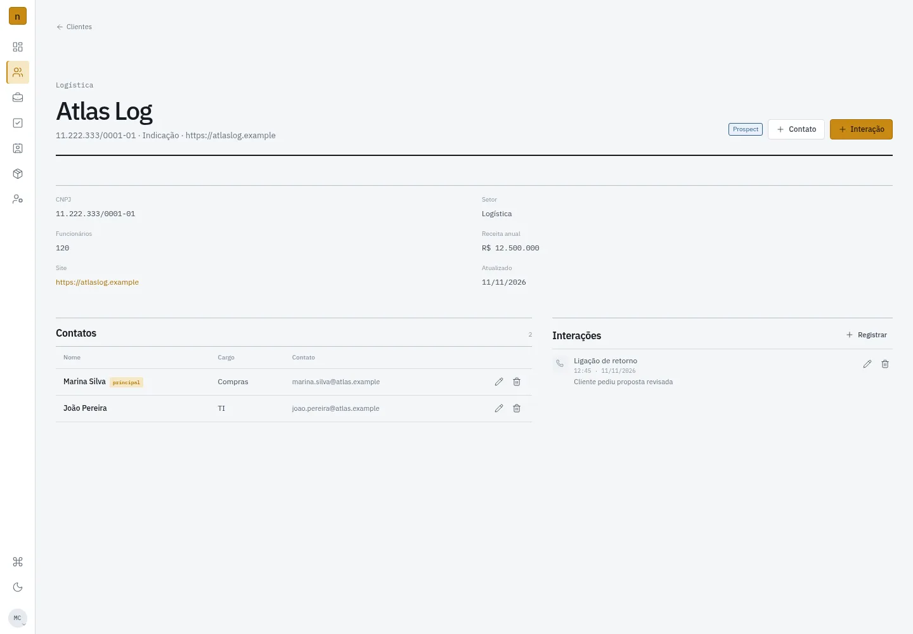
      <br><sub><b>Ficha do cliente</b> — dados cadastrais, contatos e histórico de interações.</sub>
    </td>
  </tr>
  <tr>
    <td width="50%">
      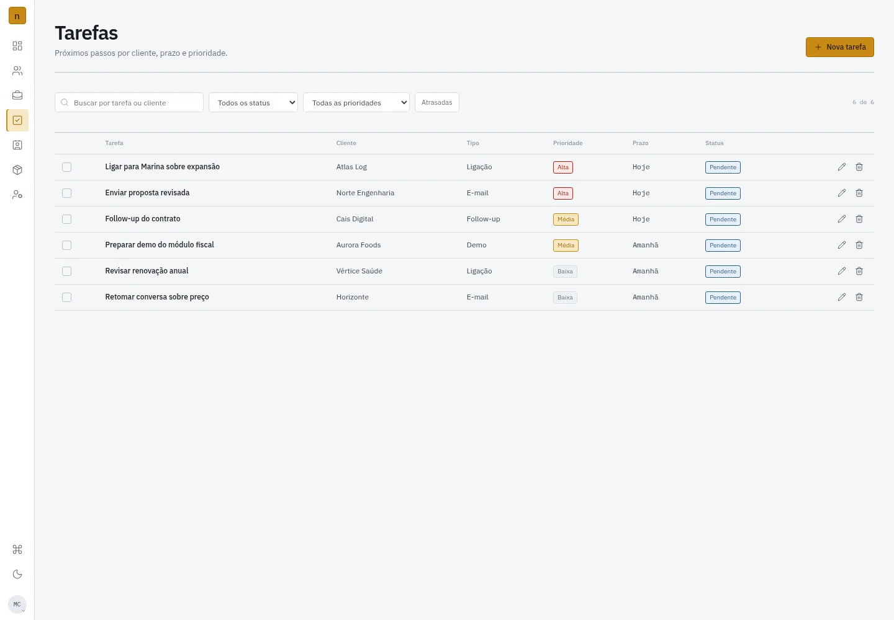
      <br><sub><b>Tarefas</b> — prioridade, prazo, atraso e conclusão.</sub>
    </td>
    <td width="50%">
      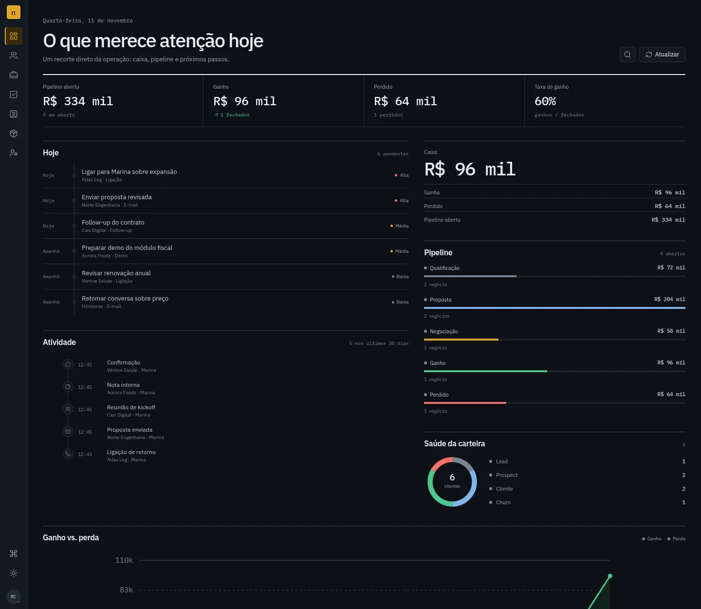
      <br><sub><b>Tema escuro</b> — o sistema acompanha a preferência do sistema.</sub>
    </td>
  </tr>
</table>

<details>
<summary>Mais telas</summary>

<table>
  <tr>
    <td width="50%">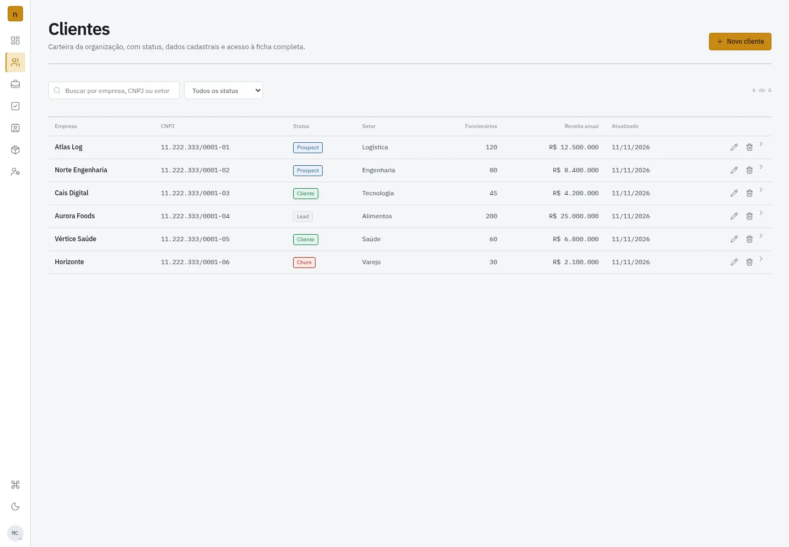<br><sub>Clientes</sub></td>
    <td width="50%">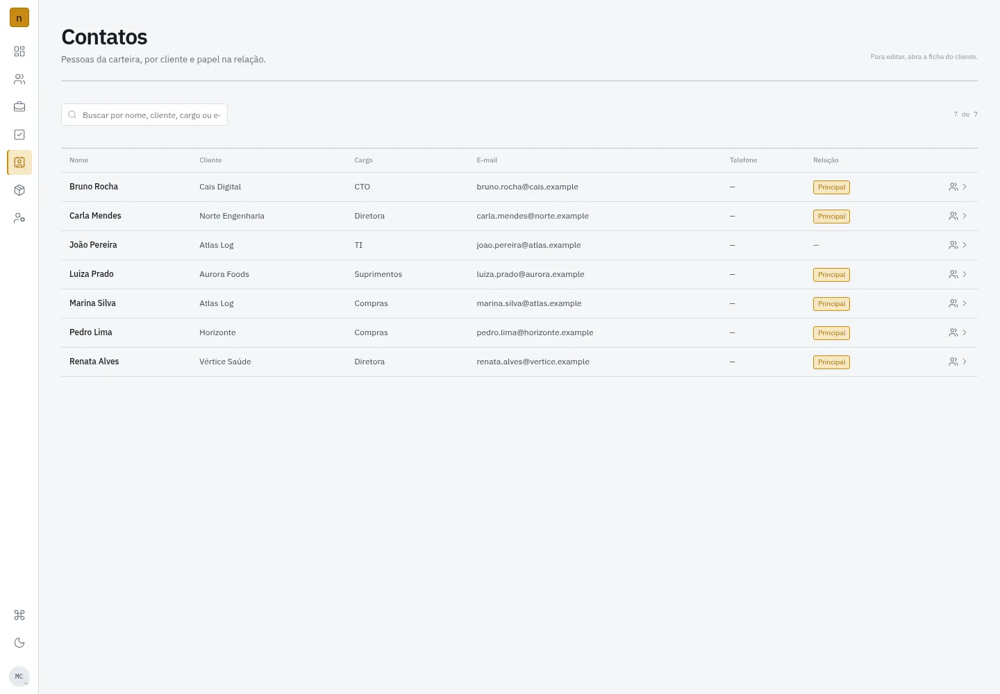<br><sub>Contatos</sub></td>
  </tr>
  <tr>
    <td width="50%">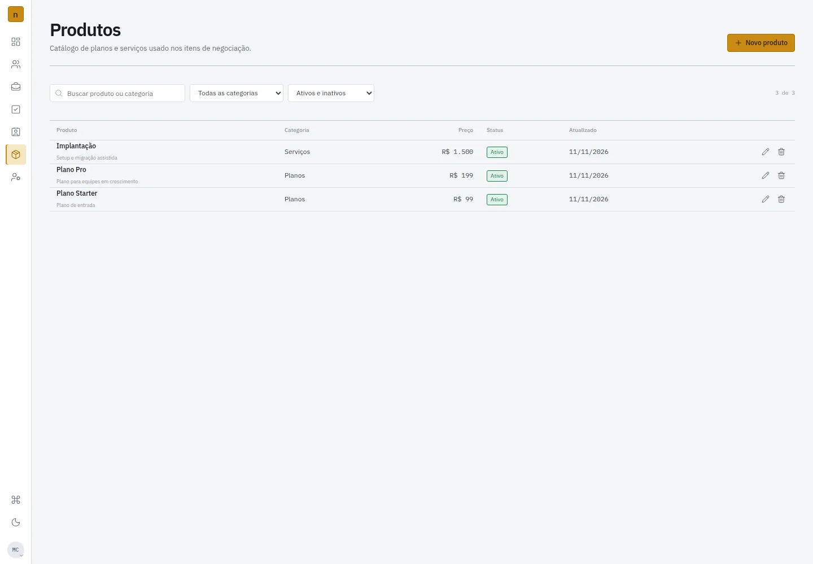<br><sub>Produtos</sub></td>
    <td width="50%">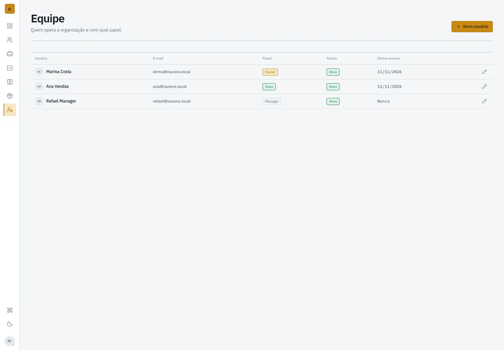<br><sub>Equipe</sub></td>
  </tr>
  <tr>
    <td width="50%">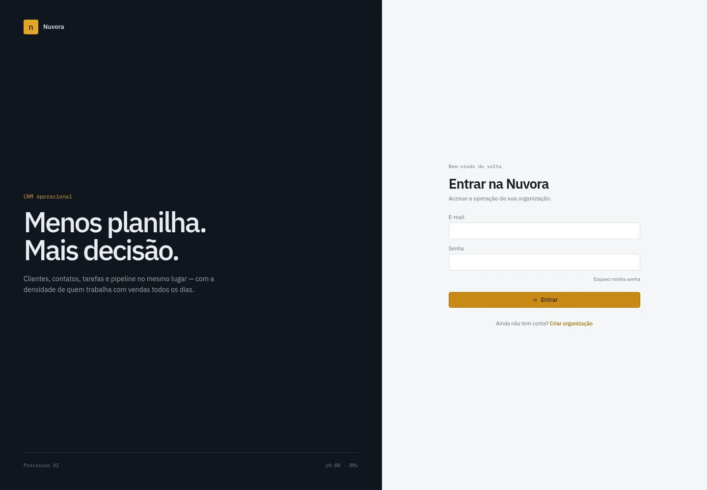<br><sub>Login</sub></td>
    <td width="50%">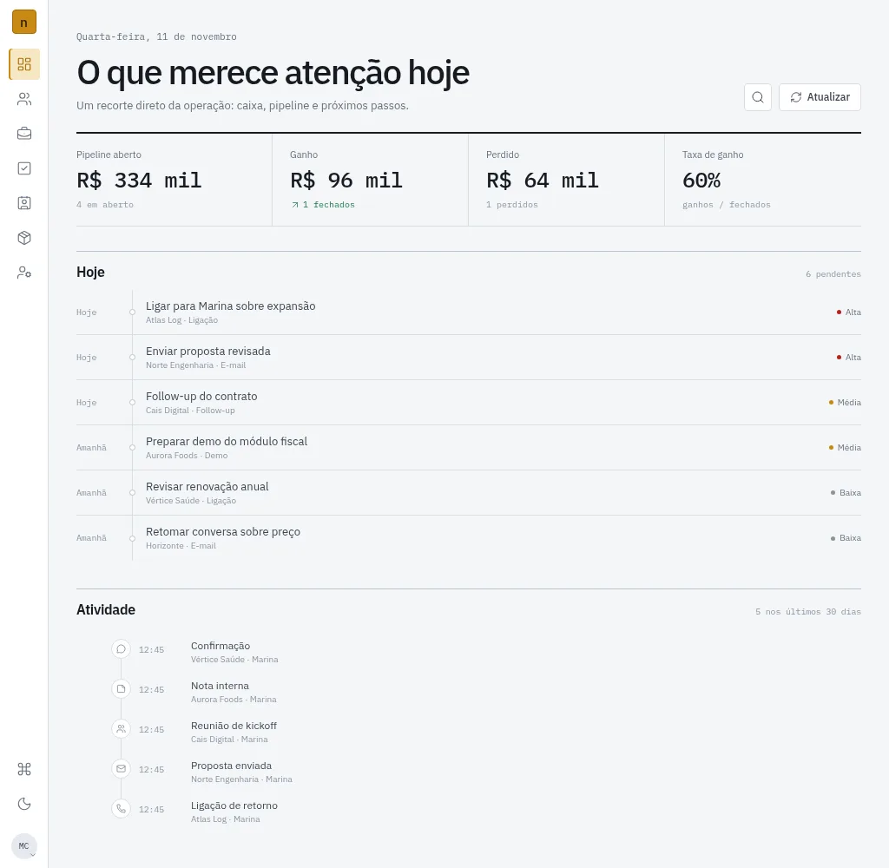<br><sub>Responsivo</sub></td>
  </tr>
</table>

</details>

## Funcionalidades

### Autenticação e organização
- Cadastro de organização + primeiro usuário `OWNER`.
- Login com JWT, sessão restaurada no frontend e logout.
- Recuperação e redefinição de senha por token.
- Isolamento de dados por organização e autorização por papel:
  `OWNER`, `ADMIN`, `MANAGER`, `SALES`, `SUPPORT`.
- `maxUsers` aplicado na criação de usuários; último `OWNER` ativo protegido.

### Carteira e relacionamento
- CRUD de clientes com busca, status, CNPJ, setor, receita e funcionários.
- Ficha do cliente com contatos e histórico de interações.
- Contato principal único por cliente.
- Interações com tipo, assunto, contato, duração e descrição.
- Diretório global de contatos com busca.

### Pipeline comercial
- Negócios em kanban e tabela, com filtros e busca.
- Criação, edição, mudança de estágio por drawer ou drag-and-drop.
- Motivo obrigatório para `CLOSED_LOST`; probabilidade alinhada a ganho/perda.
- Itens de negociação com produto, quantidade, preço, desconto e total calculado no servidor.
- Proteção de exclusão: negócio com itens e produto usado não são removidos.

### Tarefas e catálogo
- Tarefas com cliente, negócio opcional, tipo, prioridade, prazo e status.
- Filtros de status, prioridade e atrasadas; conclusão/reabertura.
- Catálogo de produtos com escrita restrita a `OWNER`/`ADMIN`/`MANAGER`.

### Dashboard
- Pipeline por estágio, ganho/perda e taxa de ganho.
- Tarefas do dia e atividade recente.
- Saúde da carteira e maiores negócios abertos.
- Dados agregados pela API, respeitando o escopo do usuário.

## Stack

| Camada | Tecnologia |
|---|---|
| Backend | NestJS 11, Fastify, TypeScript |
| Banco | PostgreSQL 16, TypeORM, migrations versionadas |
| Frontend | React 19, TypeScript, Vite, React Router |
| UI | Design system próprio, IBM Plex Sans/Mono, CSS tokens |
| Auth | JWT, bcrypt, guards globais, RBAC |
| Infra local | Docker Compose, PostgreSQL 16 |
| Testes | Jest, Supertest, PostgreSQL descartável |

## Arquitetura

```text
┌──────────────────────┐        /api        ┌──────────────────────────┐
│ web/                 │  Vite proxy dev    │ src/                     │
│ React + TypeScript   │ ─────────────────► │ NestJS + Fastify         │
│ React Router         │                    │ JWT / RBAC / validação   │
└──────────────────────┘                    └────────────┬─────────────┘
                                                         │ TypeORM
                                                         ▼
                                            ┌──────────────────────────┐
                                            │ PostgreSQL 16            │
                                            │ Docker Compose           │
                                            └──────────────────────────┘
```

- `PRODUCT.md` registra usuários, capacidades e princípios do produto.
- `DESIGN.md` registra a direção visual **Briefing / Precision UI**.
- `web/` é o app final; `web/src/proposals/` guarda as propostas visuais que originaram a escolha.

## Rodando localmente

### Pré-requisitos

- Node.js 22+
- npm
- Docker + Docker Compose
- Git

### 1. Backend e banco

```bash
git clone https://github.com/EdevandoAlves/api-nuvora-crm.git
cd api-nuvora-crm

cp .env-example .env
docker compose up -d db

npm install
npm run migration:run
npm run seed
npm run start:dev
```

A API fica em `http://localhost:3000` e o Swagger em `http://localhost:3000/api`.

O `seed` cria a organização **Nuvora Demo** com clientes, contatos, negócios, tarefas, interações, produtos e três usuários. Ele é idempotente: se a organização demo já existir, não altera nada.

### 2. Frontend

Em outro terminal:

```bash
cd web
npm install
npm run dev
```

Abra `http://localhost:5173`.

Em desenvolvimento, o Vite faz proxy de `/api` para `http://127.0.0.1:3000`. Para outro ambiente, defina `VITE_API_URL` com a URL pública da API.

### Contas de demonstração

| Papel | E-mail | Senha |
|---|---|---|
| Owner | `demo@nuvora.local` | `Demo1234!` |
| Sales | `ana@nuvora.local` | `Demo1234!` |
| Manager | `rafael@nuvora.local` | `Demo1234!` |

O usuário `Sales` demonstra o isolamento por carteira e as restrições de escrita. O `Manager` consulta a organização sem gerenciar equipe.

### Variáveis de ambiente

O `.env-example` já funciona com o Docker Compose local. Para produção, troque pelo menos:

- `SECRET_KEY` — assinatura dos JWTs.
- `TYPEORM_PASSWORD` — senha do PostgreSQL.
- `FRONTEND_URI` — base do link de redefinição de senha.
- `SMTP_*` — credenciais reais para envio de e-mail.

Sem SMTP real, a solicitação de recuperação responde de forma genérica, mas o e-mail não é entregue.

## Testes e qualidade

```bash
# Backend
npm test
npm run test:e2e
npm run build

# Frontend
cd web
npm run build
npm run lint
```

- **2 testes unitários** e **20 testes E2E** no backend.
- Os E2E usam um banco PostgreSQL descartável (`nuvora_crm_test`), criado e removido automaticamente.
- `schema:log` do TypeORM fica limpo em relação às migrations.
- Frontend validado com build, lint, smoke test das rotas principais como `OWNER` e `SALES`, além de inspeção visual em desktop/tablet e temas claro/escuro.

## Estrutura

```text
api-nuvora-crm/
├── src/                        # API NestJS
│   ├── auth/ users/ customers/ contacts/ interactions/
│   ├── deals/ deal-products/ tasks/ products/ dashboard/
│   ├── entity/                 # Entidades TypeORM
│   ├── migration/              # Migrations versionadas
│   └── common/                 # JWT, RBAC, tenant context
├── test/                       # E2E com banco descartável
├── scripts/seed-demo.ts        # Organização de demonstração
├── web/                        # React + TypeScript + Vite
│   ├── src/app/                # App, auth, páginas e UI
│   ├── src/styles/             # Tokens e direção visual
│   └── src/proposals/          # Propostas visuais de referência
├── docs/screenshots/           # Imagens reais das telas
├── docker-compose.yml          # PostgreSQL local
├── docker/initdb/              # Extensões do Postgres
├── PRODUCT.md
├── DESIGN.md
└── README.md
```

## Decisões que valem destacar

- **Multi-tenant desde o banco:** consultas filtram `organizationId` e, para papéis operacionais, também o `ownerId`.
- **RBAC em camadas:** `JwtAuthGuard` + `RolesGuard` no Nest e controles de escrita no frontend.
- **Migrations, não `synchronize`:** o schema é versionado e validado por `schema:log`.
- **Dados reais no frontend:** nenhum mock nas telas entregues.
- **Precision UI:** interface compacta, bordas de 1px, sem sombras, IBM Plex, âmbar como único acento de ação.
- **Seed reproduzível:** qualquer pessoa consegue recriar a organização demo e ver o produto com dados.

## Limitações e roadmap

- Sem cobrança/upgrade de plano; `maxUsers` é aplicado, mas não há tela de billing.
- Sem anexos, notificações em tempo real ou integrações Gmail/WhatsApp.
- A recuperação de senha depende de SMTP configurado.
- A suíte automatizada cobre o backend; o frontend tem build/lint e smoke test manual.
- Próximos passos naturais: CI, testes E2E de frontend, anexos e notificações.

## Autor

Feito por **Edevando Alves** — [github.com/EdevandoAlves](https://github.com/EdevandoAlves).
